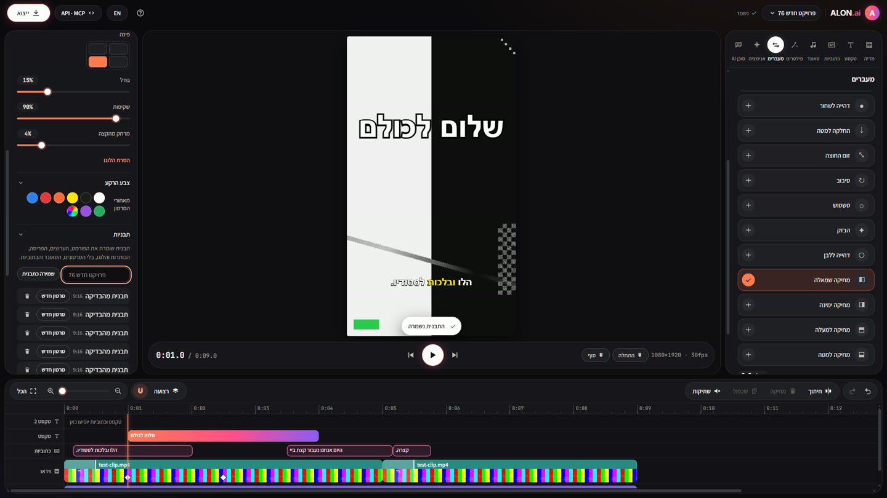
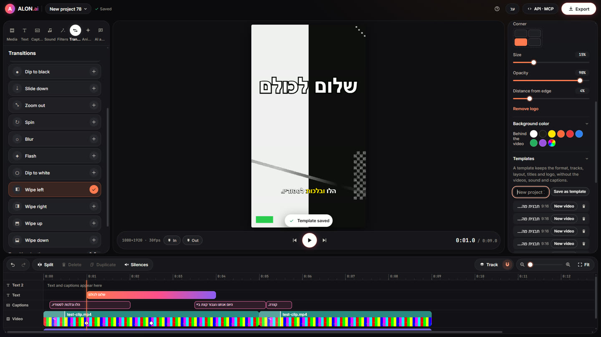
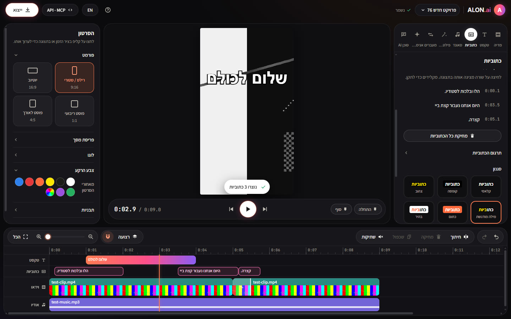
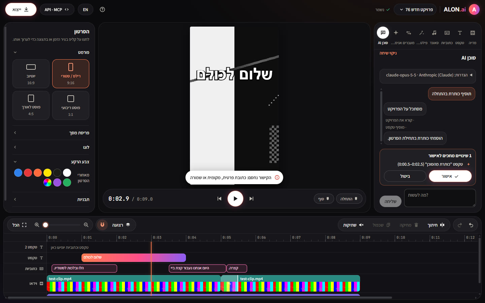

<div align="center">

# 🎬 ALON.ai Studio

### עורך וידאו מלא, עם כתוביות בעברית, רק במחשב שלך
**A local video editor with automatic Hebrew captions, an AI agent that asks before it saves, and full REST and MCP control.**

<p>
  
  
  
  
  
  
  <a href="https://github.com/alonsa-93/Alon-Studio/actions/workflows/ci.yml"></a>
</p>



</div>

---

<div dir="rtl">

## 📖 בעברית

**ALON.ai Studio** הוא עורך וידאו שרץ על המחשב שלך, בתוך הדפדפן. בלי חשבון, בלי מנוי, והסרטונים לא עולים לשום מקום. הממשק בעברית או באנגלית, וכל פעולה זמינה גם ל-AI דרך REST ו-MCP.

- ✂️ **ציר זמן מרובה ערוצים** עם גרירה, חיתוך, פיצול, מחיקה שסוגרת רווחים, הצמדה וזום
- 💬 **כתוביות אוטומטיות** עם Whisper מקומי (מודל ivrit.ai לעברית) או בענן, 10 סגנונות, הדגשת מילה ותרגום ל-9 שפות שמשאיר את התזמון
- 🎞️ **אפקטים**: 16 מעברים, נקודות מפתח, זום, מהירות, מיזוג, פריסות מסך, לוגו קבוע ותבניות
- 🔊 **סאונד**: מוזיקת רקע, 31 אפקטים קוליים, הקלטת קריינות, הקראה משיבוט קול, ונרמול עוצמה ל-14- LUFS
- 🤫 **הסרת שתיקות** בלחיצה אחת, אחרי תצוגה מקדימה, וניתנת לביטול
- 🤖 **סוכן AI** שעורך טיוטה ומראה רשימת שינויים. שום דבר לא נשמר בלי אישור
- 📤 **ייצוא MP4** בגודל הפרויקט או ליוטיוב, שורטס, רילס, טיקטוק, אינסטגרם, X ולינקדאין
- 🔒 **אבטחה**: מפתח גישה אקראי, האזנה ל-localhost בלבד, מפתחות API מוסתרים מהלוגים, וייבוא מקישורים רק מכתובות ציבוריות

המדריך המלא בעברית: [README.he.md](README.he.md)

</div>

## 🌍 In English

**ALON.ai Studio** is a video editor that runs on your own computer, in the browser. No account, no subscription, and your videos never leave the machine. The interface is Hebrew or English, and every edit is also available to AI tools over REST and MCP.

| | |
|---|---|
| ✂️ **Multi-track timeline** | drag, trim, split, ripple delete, snap and zoom |
| 💬 **Automatic captions** | local Whisper (ivrit.ai model for Hebrew) or the cloud, 10 styles, word highlight, translation to 9 languages that keeps the timing |
| 🎞️ **Effects** | 16 transitions, keyframes, punch-in zoom, speed, blend modes, screen layouts, a fixed logo, templates |
| 🔊 **Sound** | background music, 31 sound effects, voice-over, narration and voice cloning, loudness normalised to -14 LUFS |
| 🤫 **Silence removal** | one undoable step, after a preview |
| 🤖 **AI agent** | edits a draft and lists every change; nothing is saved until you approve |
| 📤 **MP4 export** | project size, or presets for YouTube, Shorts, Reels, TikTok, Instagram, X and LinkedIn |
| 🔒 **Security** | random access key, localhost only, API keys kept out of logs, link import from public addresses only |

## 📸 Screenshots
<sub>All screenshots use the generated test clips from the test suite.</sub>

| English interface | Captions |
|---|---|
|  |  |
| **AI agent with approval** | |
|  | |

---

## ⚡ Quick start (from source)
Requirements: [Node.js](https://nodejs.org) 20 or newer, and ffmpeg with ffprobe on the `PATH` (`winget install Gyan.FFmpeg`).
For local captions also Python 3.9+ with `pip install faster-whisper`.

```powershell
git clone https://github.com/alonsa-93/Alon-Studio.git
cd Alon-Studio
npm ci
npm start
```

The server prints an address like `http://localhost:5173/#k=<key>`. Open it in a browser.
The first local transcription downloads the Whisper model once (pinned revision, SHA-256 checked).

## 🚀 Windows package (daily use)
The release zip `ALON-Studio-Windows.zip` has everything inside (Node.js, ffmpeg, Python with faster-whisper), so nothing else needs to be installed. It works two ways, and both run with Windows 11 Smart App Control on, without a signed `.exe`:

1. **Portable:** extract and double-click `ALON Studio.cmd`. Nothing is installed.
2. **Installed:** double-click `התקנה.cmd`. It:
   - copies the app to `%LOCALAPPDATA%\Programs\ALON Studio` for the current user (no admin rights);
   - adds **ALON Studio** shortcuts to the Start menu and the Desktop;
   - registers an uninstaller in Settings > Apps.

   Run it again to update.

Projects and exports live in `Documents\ALON Studio` in both cases, so updating or uninstalling never touches your work.

Because the zip is not signed, Windows marks it as downloaded from the internet. **Before extracting, open the zip's Properties and tick Unblock**; otherwise Smart App Control refuses the `.cmd` files. Check the download against `ALON-Studio-Windows.zip.sha256`.

`npm run release:setup` builds an Inno Setup `ALON-Studio-Setup.exe`. Smart App Control blocks unsigned installers, so it is only useful once code signing is set up.

## 🧯 Troubleshooting

| Problem | Fix |
|---|---|
| Double-click does nothing, or Smart App Control says it blocked the file | The zip was not unblocked before extracting. Delete the extracted folder, tick **Unblock** in the zip's Properties, extract again. Or run `Get-ChildItem -Recurse \| Unblock-File` in the extracted folder. |
| Blue "Windows protected your PC" | **More info** > **Run anyway**. |
| "Extract the zip first" or "files are missing" from `התקנה.cmd` | It was started from inside the zip. Use **Extract All** first. |
| Extracting fails with a path that is too long | Extract to a short path such as `C:\ALON`. |
| "Installation failed" | The message gives the reason; the full log is `%TEMP%\alon-studio-install.log`. Usually disk space (about 1 GB) or an antivirus quarantine. Installing again is safe. |
| Antivirus quarantined `node.exe` or `ffmpeg.exe` | Restore it and add an exception, or extract again. They are the official Node.js and FFmpeg builds. |
| The page says the access key is missing (401) | Open the studio only from its shortcut or `ALON Studio.cmd`, which hands the window a secret key. A bookmark to `localhost:5199` does not work. |
| No window opens at all | Check `studio.log` (below). "used by another program" means another program holds port 5199. Restarting Windows also clears a stuck copy. |
| No Edge or Chrome | The window needs one of them. |
| First automatic captions are slow or fail | The Whisper model (about 1.5 GB) downloads once and needs internet and disk space. Try again if it was interrupted. |
| A phone video (HEVC) does not play in the preview | A preview copy is made automatically; wait a few seconds. Export always uses the original. |
| Not listed under Settings > Apps | Run `התקנה.cmd` again, then uninstall. Or delete `%LOCALAPPDATA%\Programs\ALON Studio` and the shortcuts. |

The studio's log is `Documents\ALON Studio\studio.log`. It can contain file and project names, so look before attaching it to an [issue](https://github.com/alonsa-93/Alon-Studio/issues).

## 🛠️ Development
- `npm start`: the server and the UI on one port (5173). `npm run dev`: the same, restarting on server changes.
- `npm run typecheck` · `npm run security:check` · `npm run release` · `npm run release:docs` · `npm run release:zip`.
- Every editing operation is one op in `shared/ops.ts`, available at `POST /api/projects/:id/ops` and as an MCP tool.
- Every UI string is in `src/i18n.ts`, in Hebrew and English.

### Tests
The tests run against an isolated instance (port 5182, a temporary data folder) and a local mock of every outside service. They never touch your projects or the internet.

```powershell
node scripts/test-server.mjs                     # the test instance
powershell -File scripts/make-test-media.ps1     # test clips, music and speech
node scripts/gates.mjs                           # all gates, or --only=1,2
```

| Gate | What it checks |
| --- | --- |
| 1 | TypeScript types |
| 2 | Logic regression, including both UI languages being complete |
| 3 | End to end: upload, cut, captions, export, checked with ffprobe |
| 4 | Every feature end to end, including every MCP tool and the AI providers (mocked) |
| 5 | Security: access key, origin checks, paths, malformed input, lockout, secrets in logs |
| 6 | A real browser (headless Edge) using the studio with mouse and keyboard |
| 7 | Known vulnerabilities in npm and Python dependencies |
| 8 | Saved projects still open and export the same (skipped when there are none) |
| 9 | The preview and the exported MP4 look the same (PSNR) |
| 10 | Gate 6 again with the interface in English |

## 🔐 Data and security
- **Access key:** a random 256-bit key is created on first run, readable only by the current Windows account. Without it the server answers 401, and repeated wrong keys are locked out.
- **Local only:** the server listens on localhost and accepts requests only from its own origin (Host, Origin and Sec-Fetch-Site checks).
- **Files:** import by path is limited to media files in the user's folders. Media is served with `sandbox` and no caching.
- **Network:** outside connections happen only when you ask for them. Links are fetched over http/https only, to public addresses (checked after every redirect), with size, time and type limits, and pass ffprobe before reaching the library.
- **API keys:** stored in an owner-only file, never returned (only the last 4 characters), and removed from every log line.
- **AI agent:** edits a draft only, gets only the tools for the open project, and is told that text from videos is content, not instructions.

## 🤝 Contributing and security
Issues and pull requests are welcome; see [CONTRIBUTING.md](CONTRIBUTING.md).
Found a security problem? Please report it privately, as described in [SECURITY.md](SECURITY.md).

## 📄 License
ALON.ai Studio is free software under the GNU General Public License v3.0 or later. See [LICENSE](LICENSE).
The Windows package bundles FFmpeg, Node.js, Python and other components under their own licenses; see `THIRD-PARTY-NOTICES.txt` and `sbom.cdx.json` inside the package.
